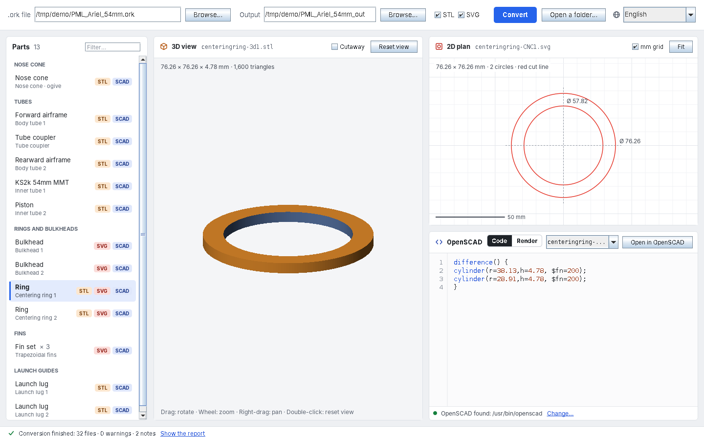

# ORKtoSCAD

ORKtoSCAD converts an [OpenRocket](https://openrocket.info/) design (`.ork`) into a set of
[OpenSCAD](https://openscad.org/) files (`.scad`), one or two per component.

- Parts you usually 3D print (nose cones, transitions, tubes, couplers, rings...) are also written directly
  as **ready-to-print STL files**: no need to install OpenSCAD for them.
- Flat parts (fins with their tab, centering rings, bulkheads) are also written as **SVG cut outlines**
  for a laser cutter or CNC router.
- The other `.scad` files can be opened in OpenSCAD and exported to **STL** (3D) or **SVG/DXF**
  (2D, for laser cutting or CNC routing).

## Supported components

| OpenRocket component | Generated file(s) | STL | SVG (cut outline) |
|---|---|---|---|
| Nose cone | `noseCone-<Shape>3D.scad` | `noseCone-<Shape>3D.stl` | — |
| Transition | `transition-3dN.scad` | `transition-3dN.stl` | — |
| Body tube | `body-tube-3dN.scad` | `body-tube-3dN.stl` | — |
| Tube coupler | `tube-coupler-3dN.scad` | `tube-coupler-3dN.stl` | — |
| Inner tube | `inner-tube-3dN.scad` | `inner-tube-3dN.stl` | — |
| Engine block | `engine-block-3dN.scad` | `engine-block-3dN.stl` | — |
| Centering ring | `centeringring-CNCN.scad` (2D), `centeringring-3dN.scad` | `centeringring-3dN.stl` | `centeringring-CNCN.svg` |
| Bulkhead | `bulkhead-cncN.scad` (2D), `bulkhead-3dN.scad` | — | `bulkhead-cncN.svg` |
| Launch lug | `launch-lug-3dN.scad` | `launch-lug-3dN.stl` | — |
| Rail button | `rail-button-3dN.scad` | `rail-button-3dN.stl` | — |
| Tube fin set | `tube-fin-3dN.scad` | `tube-fin-3dN.stl` (one tube) | — |
| Trapezoidal fin set | `trapezoidfinsetN.scad` (2D, one fin + tab) | — | `trapezoidfinsetN.svg` |
| Elliptical fin set | `ellipticalfinsetN.scad` (2D, one fin + tab) | — | `ellipticalfinsetN.svg` |
| Free-form fin set | `freeformfinsetN.scad` (2D, one fin + tab) | — | `freeformfinsetN.svg` |
| Pod set, booster (parallel stage) | the parts they contain, as above | | |

`N` is the order in which the component appears in the design (1, 2, 3...).
All dimensions are written in **millimetres**.

STL files are binary, in millimetres, and are generated by default (untick *STL* in the window
to get only `.scad` files). Each STL describes exactly the same part as the matching `.scad` file.

SVG files are also generated by default (*SVG* option in the window). See [Laser cutting / CNC (SVG)](#laser-cutting--cnc-svg).

**How many to make.** One file is written per part. When a part is needed several times (pods and
boosters with several instances, several rail buttons or launch lugs, fin count), the summary shows a
note such as `<railbutton> "Rail Button": make 2 copies`.

**Not generated.** Parachutes, streamers, shock cords and mass components are not parts to print or
cut; the summary lists how many were skipped.

### Nose cones and transitions

- Shapes: conical, ogive (tangent or secant), ellipsoid, power series, parabolic series, Haack series
  (Von Kármán, LV-Haack...), with the **shape parameter** taken from the design and the same profile
  formulas as OpenRocket. Transitions also support OpenRocket's **clipped** option.
- Hollow parts: the wall thickness is measured perpendicular to the surface, as in OpenRocket.
  Solid ("filled") parts are supported.
- Shoulders are included (open or closed, as set in OpenRocket) and joined to the wall, so each part
  prints as a single solid.
- Orientation: aft end at z = 0, fore end (tip) at the top; the aft shoulder is below, the fore shoulder
  of a transition above.
- If several nose cones have the same shape (pods, boosters), the next ones are named
  `noseCone-<Shape>3D-2`, `-3`...

### Fins

- One fin per file, seen from the side: root chord on the bottom edge, **tab** below it. The number of
  fins to cut is given in the summary (`make 4 fins`).
- The tab is placed exactly like in OpenRocket, from the fin's leading edge, for the three reference
  modes: *front/top* (offset from the leading edge), *center/middle* (offset from the centered position),
  *end/bottom* (offset from the trailing edge).
- Fin thickness, cross-section (rounded, airfoil) and fillets are not part of the 2D outline.

### Laser cutting / CNC (SVG)

- The SVG page is sized in **millimetres** (`width="84mm"`...), so the part imports at its real size in
  LightBurn, Inkscape, LaserGRBL, Fusion... Check that your software does not rescale on import
  (Inkscape: *Import* keeps the size; some tools assume 96 DPI only for files without units).
- Each part is a single **red hairline** (0.1 mm) without fill: one closed outline for a fin and its tab,
  concentric circles for rings and bulkheads (true circles, not polygons).
- The part name is stored in the SVG title only: there is no visible text that could be engraved.
- No kerf compensation is applied: set the kerf/offset in your laser or CAM software.

### Rail buttons

Base and flange use the outer diameter, the waist uses the inner diameter, with the heights from the
design (OpenRocket's defaults for older files that do not store them). The screw and its hole are not
modelled: drill the hole or add it in OpenSCAD.

### Not supported (yet)

- Fins are only generated in 2D (no STL, fin thickness is not used). Fin roots are flat (fins on a
  transition do not follow its curve).
- Long body tubes are written in one piece, even if they do not fit on your printer.
- A part inside a pod or booster whose size is a plain `auto` with nothing to take it from is skipped
  with a warning (OpenRocket would use a 25 mm default). Files saved by recent OpenRocket versions store
  the computed value next to `auto`, which is used.

## Requirements

- Java **16 or newer** (a JRE is enough to run; a JDK is needed to build).
- A desktop session (the program is a window).
- [OpenSCAD](https://openscad.org/downloads.html) is optional: it is only needed for the **Render** tab
  of the window and to edit or export `.scad` files. STL and SVG files are written without it.

## Usage

Run the program:
```
java -jar orkToScad.jar
```
(On most systems you can also double-click `orkToScad.jar`, or start the `.exe` built with
`build-exe.ps1`, see [docs/README.md](docs/README.md).) To convert a file right away: `java -jar orkToScad.jar my-rocket.ork`.

The window opens directly, in the language of your system: English, French, German, Spanish, Italian,
Portuguese, Dutch, Polish, Russian, Turkish or Hungarian (English for other systems). The language can be changed
at any time with the selector at the top right (the choice is remembered; *Automatic* goes back to the system's
language). The conversion report follows the chosen language too.

The **Help** menu opens the PDF user manual in the current language (<kbd>F1</kbd>) and the *About* box
(version, author, contact).



1. **Convert**: choose the file in *.ork file* (or **drag and drop a `.ork` file onto the window**, which
   converts it at once), check the output folder in *Output* (by default a `<name>_out` folder next to the
   `.ork` file, created if needed), tick *STL* / *SVG* if you want those files, then click **Convert**.
2. **Parts** (left column): every generated part, grouped by kind (nose cone, transitions, tubes, rings and
   bulkheads, fins, launch guides), with the name given in OpenRocket, the number of copies to make
   (`× 3`) and badges for the files available (STL, SVG, SCAD). Use *Filter…* to search.
3. **Previews** of the selected part, in three boxes (drag the gaps between them to resize):
   - **3D view** (STL): left-drag to rotate, wheel to zoom, right-drag to pan, double-click or *Reset view*
     to reset. *Cutaway* cuts the part in half to check wall thicknesses, shoulders and caps; outer surfaces
     are orange, inner surfaces blue. Size (mm) and triangle count are shown at the top.
   - **2D plan** (SVG): the cut outline in red on a millimetre grid (*mm grid*), with the overall size,
     the diameters of rings and bulkheads, a scale bar and the number of copies to cut. Wheel to zoom,
     drag to pan, *Fit* or double-click to fit.
   - **OpenSCAD**: *Code* shows the `.scad` file (coloured, line numbers; a selector when a part has two
     files, e.g. the 3D and CNC files of a ring). *Render* shows the part rendered by OpenSCAD itself
     (first render a few seconds, then cached). *Open in OpenSCAD* opens the file to edit it.
     OpenSCAD is found automatically (usual install folders and the PATH); otherwise use
     *Tell where it is installed…* at the bottom of the box.
   When a part has no file of a kind, the box says why (for example, fins have no STL: they are flat parts).
4. **Status bar**: number of files, warnings and notes; *Show the report* shows the full report.
5. **Open a folder…** shows the files of an earlier conversion without converting again (the part names
   are then deduced from the file names).

The last files, options and language are remembered in `.orktoscad.properties` in your home folder.

The `.stl` files can go straight to your slicer and the `.svg` files to your laser or CNC software. To change
a part, open its `.scad` file in OpenSCAD:
- 3D parts: **Render (F6)**, then **File > Export > Export as STL**.
- 2D parts (fins, `-cnc` / `-CNC` files): **Render (F6)**, then **File > Export > Export as SVG** or **DXF**.
- Nose cone and transition files start with their parameters (length, radii, wall thickness, shape
  parameter, shoulders...): edit them and render again.

The program never writes anything next to your `.ork` file except in the output folder, and never modifies
the input file.

### Input file formats

All `.ork` flavours produced by OpenRocket are accepted; the format is detected automatically:

- ZIP archive containing `rocket.ork` (current OpenRocket versions),
- GZIP-compressed XML (older versions, e.g. the PML sample files in `tests/`),
- plain XML.

### "auto" dimensions

When OpenRocket stores a dimension as `auto`, ORKtoSCAD computes it the same way OpenRocket does
(simplified):

- body tube radius: from the previous component (nose cone, body tube or transition), otherwise from the next one;
- tube coupler, bulkhead and centering ring outer radius: inner radius of the tube they are mounted in;
- centering ring inner radius: outer radius of the inner tube(s) mounted at the same place in the same tube
  (a solid disk if there is none);
- nose cone shoulder radius: inner radius of the following body tube;
- transition radii: radius of the component before (fore) and after (aft) it;
- engine block outer radius: inner radius of the tube it is mounted in;
- tube fin radius: body tube radius for 1 or 2 tubes, otherwise the radius at which the tubes touch.

Inside a pod or a booster, only the components of that pod or booster are used.

If a value cannot be resolved, the component is skipped and a warning explains why: no file is ever
generated with zero dimensions.

### Customising the nose cone and transition templates

`.scad` nose cones and transitions are generated from [`openscad/noseCone.scad`](openscad/noseCone.scad)
and [`openscad/transition.scad`](openscad/transition.scad), which are also bundled inside the jar. They build
the half-profile in 2D and turn it into a solid with a single `rotate_extrude()`, so they render in about a
second. To use your own version, place an `openscad` folder **next to `orkToScad.jar`** containing your
template(s). The placeholders (`##shape##`, `##length##`, `##thickness##`, `##shapeparameter##`, the radii
and the shoulder values) are replaced by the values from the design; see the top of each template.

The STL files are computed in Java (`OrShapes`, `NoseConeShape`, `TransitionShape`, `RevolvedSolid`) with
the same formulas and the same construction; if you change the profile formulas in a template, the STL
will not follow.

## Project layout

```
src/orkToScad/        Java sources
  Main.java             entry point (optional .ork argument)
  Converter.java        converts one .ork file (no user interface, reusable/testable)
  OrkReader.java        reads ZIP / GZIP / XML .ork files safely
  OrkValues.java        reads dimensions, resolves "auto" values (also in pods and boosters)
  NodeProcessor.java    walks the design tree, notes copies and skipped components
  ScadGenerator.java    writes the .scad (and .stl) files
  OrShapes.java         nose cone / transition shape formulas (same as OpenRocket)
  BodyShape.java        outline of a nose cone or transition along the axis
  NoseConeShape.java    nose cone outline
  TransitionShape.java  transition outline, including clipped shapes
  RevolvedSolid.java    builds solids of revolution and writes binary STL
  MainWindow.java       the window: toolbar, parts, three previews, status bar
  PartsPanel.java       list of parts (groups, badges, filter, drop zone)
  Part.java             a part and its files (from a conversion or from a folder)
  PreviewBox.java       one preview box (header, tools, content or message)
  StlMesh.java          reads STL files (binary and ASCII)
  StlViewPanel.java     3D view of an STL part (software z-buffer)
  SvgViewPanel.java     2D view of an SVG cut outline (grid, dimensions)
  ScadPanel.java        OpenSCAD code (coloured) and render
  OpenScad.java         finds OpenSCAD, renders a .scad file to an image, opens it
  Settings.java         remembered files and options
  UiKit.java            colours and small components of the window
  I18n.java             translations, plural forms, number formats, system language
  HelpMenu.java         Help menu: PDF user manual, About box
  FlatParts.java        2D geometry of fins and tabs (tab placed like OpenRocket)
  SvgWriter.java        writes SVG cut outlines in millimetres
  FileUtils.java        number formatting, file writing, template loading
  ConversionReport.java generated files, warnings and errors
src/orkToScad/i18n/   texts in 11 languages (messages_en.properties is the reference)
src/orkToScad/res/    icon shown in the About box
manual/               PDF user manuals, one per language (bundled in the jar)
openscad/             nose cone and transition templates (bundled in the jar)
tests/                sample .ork files (PML kits, GPL-2.0, see tests/README.md)
docs/README.md        how to build
docs/manual/          sources, screenshots and build script of the PDF manuals
build-exe.ps1         builds the jar and the Windows .exe (jpackage)
```

## Development & contributing

See [docs/README.md](docs/README.md) to build the project.
